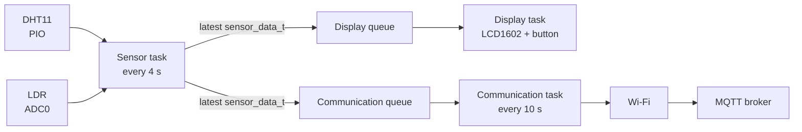

<div align="center">

# Pico Weather Station

A weather station based on the Raspberry Pi Pico W, FreeRTOS, a DHT11 temperature/humidity sensor, an LDR, an I2C LCD, and MQTT.


</div>

## About

This project collects environmental measurements with a Raspberry Pi Pico W and makes them available in two ways:

- locally on a 16x2 LCD display;
- remotely through an MQTT broker over Wi-Fi.

The firmware is written in C and uses the Raspberry Pi Pico SDK, FreeRTOS, lwIP MQTT, ADC, I2C, and PIO.

## Features

- Temperature and humidity measurements with a DHT11.
- Ambient light measurement with an LDR connected to the ADC.
- Local display on an LCD1602 through a PCF8574 I2C backpack.
- Display mode switching with a push button.
- Wi-Fi station mode on the Pico W.
- MQTT publication of the latest sensor values.
- FreeRTOS tasks and queues separating acquisition, display, and communication.

## Hardware and Wiring

### Components

- Raspberry Pi Pico W
- DHT11 (3 pins) temperature and humidity sensor
- LDR/photoresistor
- Resistor for the LDR voltage divider: 10 kΩ resistor
- 16x2 character LCD with a PCF8574 I2C backpack (I2C address `0x27`)
- Push button for changing the display mode
- Breadboard, jumper wires, and a suitable USB power supply

### Pin Assignment

| Function | Pico W pin / GPIO | Notes |
| --- | --- | --- |
| LDR analog output | GPIO26 / ADC0 | LDR voltage-divider output |
| LCD SDA | GPIO4 | I2C0 |
| LCD SCL | GPIO5 | I2C0 |
| DHT11 data | GPIO15 | DHT11 single-wire data line |
| Display button | GPIO14 | Use GPIO14 with a pull-down resistor |

### Wiring Diagram

To reproduce this project, wire the components according to the diagrams below. Please note that the **DHT11** data line requires a pull-up resistor (typically 4.7 kΩ to 10 kΩ), which is already built into the module used here. Similarly, the **I2C LCD** relies on integrated pull-up resistors on its PCF8574 backpack for the SDA and SCL lines. Finally, the **push button** is configured with a pull-down resistor, and the **LDR** is wired into a voltage divider with a fixed resistor to allow analog readings.

<summary><b> Schematic diagram </b></summary>


<summary><b> Breadboard wiring diagram </b></summary>


## Architecture

The firmware starts three FreeRTOS tasks. The sensor task overwrites the latest value in two one-item queues. The display task is notified when new data arrives, while the communication task periodically publishes the latest value.



### Tasks

| Task | Responsibility | Period / priority |
| --- | --- | --- |
| `task_sensors` | Reads the DHT11 and LDR, then updates both queues | 4 s / priority 2 |
| `task_display` | Updates the LCD after sensor or button notifications | Event-driven / priority 3 |
| `task_comm` | Connects to Wi-Fi and MQTT, then publishes sensor data | 10 s / priority 1 |

## MQTT Message Format

The firmware publishes to:

```text
home/pico-weather-station/data
```

The payload is JSON:

```json
{
	"temp": 23.4,
	"hum": 56,
	"lum": 72
}
```

| Field | Type | Description | Unit |
| --- | --- | --- | --- |
| `temp` | number | Temperature from the DHT11 | °C |
| `hum` | integer | Relative humidity from the DHT11 | % |
| `lum` | integer | LDR reading scaled from ADC to a percentage | % |

MQTT currently uses port `1883`, client ID `pico`, keep-alive `60` seconds, QoS `0`, and retain `false`.

## Tech Stack

- C11
- ARM GCC toolchain `15.2.1`
- Raspberry Pi Pico SDK `2.3.1`
- Raspberry Pi Pico W (`pico_w`)
- FreeRTOS Kernel
- lwIP MQTT client
- CMake and Ninja
- PIO for the DHT11 timing-sensitive protocol
- ADC for the LDR
- I2C for the LCD1602

## Installation & Setup

### Prerequisites

Install the following tools:

- CMake
- Ninja
- ARM GCC toolchain compatible with the Pico SDK
- Raspberry Pi Pico SDK
- `picotool`
- A USB cable capable of data transfer

The project expects the Pico SDK and tools installed through the Raspberry Pi Pico VS Code extension, or available through the usual SDK environment variables.

### Configure Wi-Fi and MQTT

Create or update `include/wifi_secrets.h` locally. This file is intentionally not documented with real credentials:

```c
#define WIFI_SSID "your-wifi-name"
#define WIFI_PASSWORD "your-wifi-password"
#define MQTT_BROKER_IP "192.168.1.100"
#define MQTT_USER "your-mqtt-user"
#define MQTT_PASS "your-mqtt-password"
```

## Installation & Setup: Build

From the project root:

```bash
cmake -S . -B build -G Ninja
ninja -C build
```

The build generates firmware files such as `build/main.uf2` and `build/main.elf`.

In VS Code, the same operation is available through the **Compile Project** task.

## How to Use

1. Connect the hardware according to the wiring diagram.
2. Add the local Wi-Fi and MQTT configuration.
3. Build the project.
4. Put the Pico W into BOOTSEL mode and copy `build/main.uf2` to the mounted board, or use `picotool`.
5. Power-cycle the board and wait for the Wi-Fi and MQTT connection.
6. Check the LCD for local readings and subscribe to the MQTT topic.
```

## Project Structure

```text
.
├── CMakeLists.txt
├── docs/
│   └── images/
│   	├── pico-weather-station_bb.png
		├── pico-weather-station_schem.png
		└── weather-station.jpg
├── include/
│   ├── config.h
│   ├── display_modes.h
│   ├── FreeRTOSConfig.h
│   ├── lwipopts.h
│   ├── sensor_data.h
│   └── wifi_secrets.h              # Local credentials; do not commit
├── lib/
│   └── FreeRTOS-Kernel/
└── src/
		├── main.c
		├── drivers/
		│   ├── dht11_pio.c/.h
		│   ├── dht11.pio
		│   ├── lcd1602_i2c.c/.h
		│   └── ldr_adc.c/.h
		└── tasks/
            ├── task_sensors.c/.h
            ├── task_display.c/.h
            └── task_comm.c/.h
```

## Known Limitations

- Wi-Fi and MQTT are initialized once at startup; the communication task does not currently reconnect after a connection failure.
- The MQTT broker address is configured as an IPv4 address, not resolved from a hostname.
- MQTT uses QoS 0, so messages are not acknowledged or persisted by the protocol.
- The LDR percentage is a simple linear conversion from the 12-bit ADC value; it is not calibrated to physical illuminance in lux.
- The DHT11 has relatively low accuracy and a limited sampling rate compared with more modern sensors.
- Sensor data is only forwarded after a valid DHT11 checksum; invalid readings are discarded.
- Each queue stores only the latest measurement, so older measurements are intentionally overwritten.
- The exact wiring, resistor values, enclosure, power supply, and calibration are hardware-dependent.
