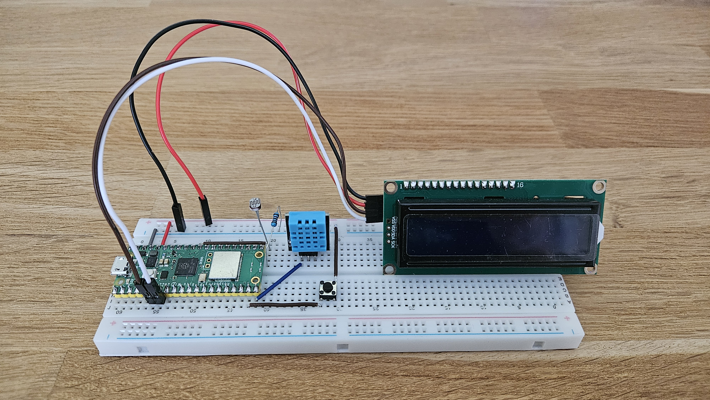
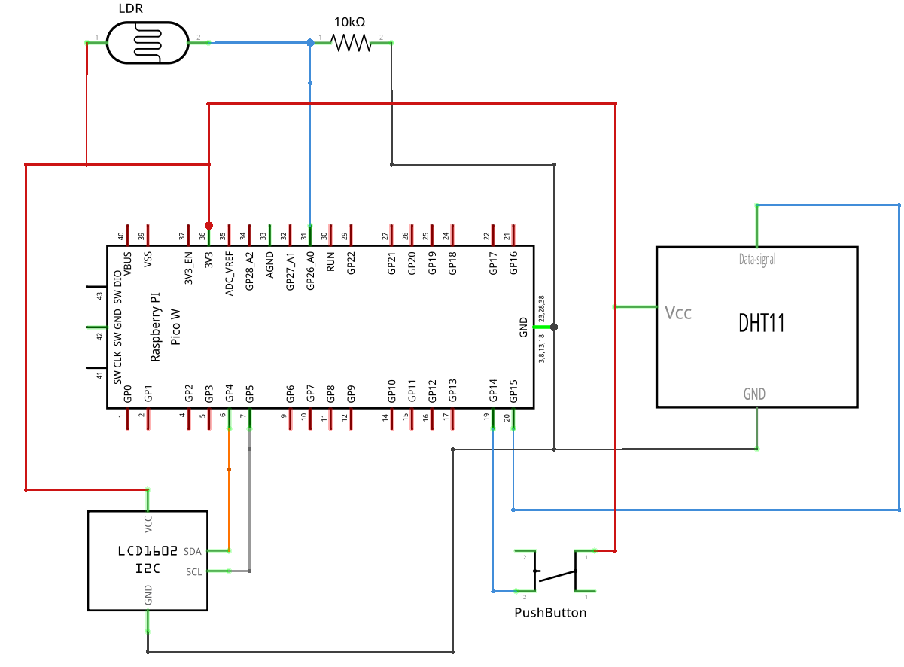
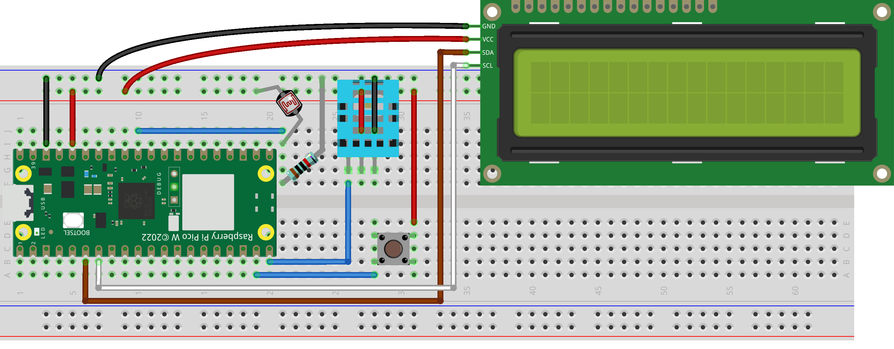
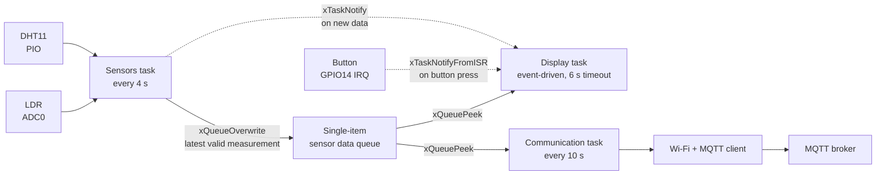

<div align="center">

# Pico Weather Station

A weather station based on the Raspberry Pi Pico W, FreeRTOS, a DHT11 temperature/humidity sensor, an LDR, an I2C LCD, and MQTT.



</div>

## About

This project collects environmental measurements with a Raspberry Pi Pico W, displays them locally on a 16x2 LCD, and publishes them remotely via MQTT over Wi-Fi.

### Features

- FreeRTOS tasks and queue isolate sensor acquisition, display, and Wi-Fi communication.
- 16x2 LCD display (with mode switching via button) + JSON payload published via MQTT.
- Custom PIO state machine for DHT11 timings, ADC for LDR light measurements, and I2C for the screen.

## Hardware and Wiring

### Components

- Raspberry Pi Pico W
- DHT11 (3 pins) temperature and humidity sensor
- LDR/photoresistor
- Resistor for the LDR voltage divider: 10 kΩ resistor
- 16x2 character LCD with a PCF8574 I2C backpack (I2C address `0x27`)
- Push button for changing the display mode
- Breadboard, jumper wires, and a suitable USB power supply

### Pin Assignment

| Function | Pico W pin / GPIO | Notes |
| --- | --- | --- |
| LCD SDA | PIN 6 / GPIO4 | I2C0 |
| LCD SCL | PIN 7 / GPIO5 | I2C0 |
| Display button | PIN 19 / GPIO14 | Button between GPIO14 and 3V3; <br/>internal pull-down enabled in firmware (rising-edge interrupt) |
| DHT11 data | PIN 20 / GPIO15 | DHT11 single-wire data line |
| LDR analog output | PIN 31 / GPIO26 | ADC0, LDR voltage-divider output |


### Wiring Diagram

To reproduce this project, wire the components according to the diagrams below. Note that the DHT11 and PCF8574 LCD backpack already include their respective pull-up resistors.

<details>
<summary><b> Schematic diagram </b></summary>

</details>

<details>
<summary><b> Breadboard wiring diagram </b></summary>

</details>

## Firmware Structure


Solid arrows carry data through the queue. Dashed arrows are task notifications that wake the display task.

### Tasks

| Task | Responsibility | Period / priority |
| --- | --- | --- |
| `task_sensors` | Reads the LDR and DHT11. If the DHT11 checksum is valid, timestamps the measurement and overwrites the queue, then notifies the display task. | 4 s / priority 2 |
| `task_display` | Wakes on a sensor or button notification, or after a timeout. Reads the queue without consuming it and refreshes the LCD, or shows `OUTDATED DATA` when the measurement is outdated. | Event-driven, 6 s timeout / priority 3 |
| `task_comm` | Connects to Wi-Fi and MQTT, Reads the queue without consuming it and then publishes the latest measurement if it is not outdated. | 10 s / priority 1 |

### Display Modes

The button cycles through four modes. `OUTDATED DATA` is shown automatically and is not part of the cycle.

| Mode | Content |
| --- | --- |
| Full info | Temperature, humidity, luminosity with a 4-segment bar |
| Temperature | Temperature in °C |
| Humidity | Relative humidity in % |
| Luminosity | Luminosity in % with a 4-segment bar |
| `OUTDATED DATA` | Automatic, when no fresh measurement is available |

### MQTT Message Format
Topic: `home/pico-weather-station/data`  
Payload (JSON): `{"temp":23.4,"hum":56,"lum":72}`

| Field | Type | Description | Unit |
| --- | --- | --- | --- |
| `temp` | float | Temperature from the DHT11 | °C |
| `hum` | integer | Relative humidity from the DHT11 | % |
| `lum` | integer | LDR reading scaled from ADC to a percentage | % |

MQTT parameters are defined in `include/config.h`.

### Data validity

DHT11 frames are accepted only when their checksum is valid. Each accepted
measurement receives a timestamp in milliseconds since boot.

A measurement is considered fresh for 12 seconds (defined by `SENSOR_DATA_MAX_AGE_MS`). The display shows
`OUTDATED DATA` when no fresh measurement is available, and the communication
task skips MQTT publication of outdated data. Luminosity is only updated together with a valid DHT11 frame, so a DHT11 failure also makes the luminosity reading outdated.

### Status LED

| Pattern | Meaning |
| --- | --- |
| 3 flashes at boot | Wi-Fi and MQTT connected |
| 1 flash at boot | Connection failed |
| 1 flash after boot | A measurement was published (occurs every 10 s) |

## Installation & Setup

### 1. Prerequisites & Configuration
Tested with Pico SDK 2.3.1, the ARM GCC toolchain, CMake and Ninja.

```bash
git clone --recurse-submodules https://github.com/Linsisa/pico-weather-station.git
```
FreeRTOS-Kernel (V11.1.0) is expected in `lib/FreeRTOS-Kernel`.


Create `include/wifi_secrets.h` locally with your credentials and MQTT broker information, see example in `include/wifi_secrets.h.example`.

Other settings (topic, client ID, task periods, timeouts) are in `include/config.h`.


### 2. Build & Flash
Run the following commands from the project root (or use the VS Code *Compile Project* task):
```bash
mkdir build
cmake -S . -B build -G Ninja -DPICO_BOARD=pico_w
ninja -C build
```

## How to Use

1. Connect the hardware according to the wiring diagram.
2. Add the local Wi-Fi and MQTT configuration.
3. Build the project.
4. Put the Pico W into **BOOTSEL** mode and copy `build/main.uf2` to the mounted board, or use `picotool`.
5. Power-cycle the board and wait for the Wi-Fi and MQTT connection (the on-board LED flashes 3 times if both connections succeed, once if one fails).
6. Check the LCD for local readings and subscribe to the MQTT topic.
7. Open the USB serial port (for example `/dev/ttyACM0`) to read the debug logs.

## Known Limitations

- **No reconnection:** Wi-Fi and MQTT connect once at boot; the firmware does not reconnect after a failure.
- **IPv4-only broker address:** The MQTT broker must be configured as an IPv4 address (no hostname resolution).
- **No publish retries:** Messages are published with QoS 1; no retries implemented for failed publishes.
- **Uncalibrated LDR:** Light percentage is a simple linear ADC conversion, not actual physical lux.
- **DHT11 limitations:** low accuracy and a slow sampling rate. If it stops responding, the measurement is skipped and retried 4 s later.
- **No data logging:** the firmware only displays and publishes the latest readings.
- **Reduced screen brightness:** The LCD is powered directly from the Pico W's 3.3V pin, which may result in lower brightness compared to a dedicated 5V supply.


## License

This project is licensed under the **MIT License** — see the [LICENSE](LICENSE) file for details.
