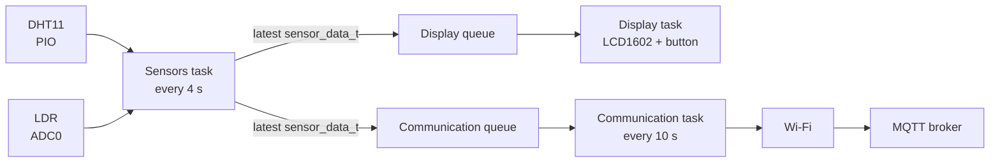

<div align="center">

# Pico Weather Station

A weather station based on the Raspberry Pi Pico W, FreeRTOS, a DHT11 temperature/humidity sensor, an LDR, an I2C LCD, and MQTT.


</div>

## About

This project collects environmental measurements with a Raspberry Pi Pico W, displays them locally on a 16x2 LCD, and publishes them remotely via MQTT over Wi-Fi.

### Features

- FreeRTOS tasks and queues isolate sensor acquisition, display, and Wi-Fi communication.
- 16x2 LCD display (with mode switching via button) + JSON payload published via MQTT.
- Custom PIO state machine for DHT11 timings, ADC for LDR light measurements, and I2C for the screen.

## Hardware and Wiring

### Components

- Raspberry Pi Pico W
- DHT11 (3 pins) temperature and humidity sensor
- LDR/photoresistor
- Resistor for the LDR voltage divider: 10 kΩ resistor
- 16x2 character LCD with a PCF8574 I2C backpack (I2C address `0x27`)
- Push button for changing the display mode
- Breadboard, jumper wires, and a suitable USB power supply

### Pin Assignment

| Function | Pico W pin / GPIO | Notes |
| --- | --- | --- |
| LDR analog output | GPIO26 / ADC0 | LDR voltage-divider output |
| LCD SDA | GPIO4 | I2C0 |
| LCD SCL | GPIO5 | I2C0 |
| DHT11 data | GPIO15 | DHT11 single-wire data line |
| Display button | GPIO14 | Use GPIO14 with a pull-down resistor |

### Wiring Diagram

To reproduce this project, wire the components according to the diagrams below. Note that the DHT11 and PCF8574 LCD backpack already include their respective pull-up resistors.

<summary><b> Schematic diagram </b></summary>


<summary><b> Breadboard wiring diagram </b></summary>


## Firmware Structure



### Tasks

| Task | Responsibility | Period / priority |
| --- | --- | --- |
| `task_sensors` | Reads the sensors and overwrites the latest values into two single-item queues. | 4 s / priority 2 |
| `task_display` | Waits for a notification and wakes up immediately when new data arrives to refresh the screen. | Event-driven / priority 3 |
| `task_comm` | Periodically reads the latest queue values and publishes them. | 10 s / priority 1 |

### MQTT Message Format
Topic: `home/pico-weather-station/data`  
Payload (JSON): `{"temp": 23.4, "hum": 56, "lum": 72}`


| Field | Type | Description | Unit |
| --- | --- | --- | --- |
| `temp` | float | Temperature from the DHT11 | °C |
| `hum` | integer | Relative humidity from the DHT11 | % |
| `lum` | integer | LDR reading scaled from ADC to a percentage | % |

## Installation & Setup

### 1. Prerequisites & Configuration
Ensure you have the **ARM GCC toolchain**, **CMake**, and the **Pico SDK** installed (e.g., via the VS Code Extension).


Create `include/wifi_secrets.h` locally with your credentials and MQTT broker information:

```c
#define WIFI_SSID "your-wifi-name"
#define WIFI_PASSWORD "your-wifi-password"
#define MQTT_BROKER_IP "192.168.1.100"
#define MQTT_USER "your-mqtt-user"
#define MQTT_PASS "your-mqtt-password"
```

### 2. Build & Flash
Run the following commands from the project root (or use the VS Code *Compile Project* task):
```bash
mkdir build
cmake -S . -B build -G Ninja -DPICO_BOARD=pico_w
ninja -C build
```
Put your Pico W into **BOOTSEL** mode and flash the generated `build/main.uf2` file.

## How to Use

1. Connect the hardware according to the wiring diagram.
2. Add the local Wi-Fi and MQTT configuration.
3. Build the project.
4. Put the Pico W into BOOTSEL mode and copy `build/main.uf2` to the mounted board, or use `picotool`.
5. Power-cycle the board and wait for the Wi-Fi and MQTT connection (3 times on-board led flashes if successful config, else 1 flash if failed).
6. Check the LCD for local readings and subscribe to the MQTT topic.

## Known Limitations

- **No Reconnection:** Wi-Fi and MQTT connect once at boot; the firmware does not auto-reconnect on failure.
- **Hardcoded Broker:** The MQTT broker must be configured as an IPv4 address (no hostname resolution).
- **QoS 1 Only:** Messages are published with QoS 1; no retries implemented for failed publishes.
- **Uncalibrated LDR:** Light percentage is a simple linear ADC conversion, not actual physical lux.
- **DHT11 Limitations:** The DHT11 sensor has low accuracy and a limited sampling rate compared to modern sensors.
- **No data logging:** The firmware does not store historical measurements; it only displays and publishes the latest readings.
- **Reduced screen brightness:** The LCD is powered directly from the Pico W's 3.3V pin, which may result in lower brightness compared to a dedicated 5V supply.
